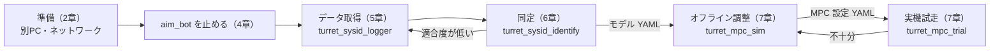

# 砲塔MPCとシステム同定 手順書

砲塔（左右 × yaw / pitch の4軸）のモータ応答を実機データから同定し、そのモデルを使う MPC（モデル予測制御）のパラメータを調整するまでの手順です。ロボットにネットワークでつながる別の PC から、この手順書だけで **データ取得 → モデル推定 → MPC 調整** まで進められるように書いています。

!!! info "今回の範囲"
    MPC は `aim_bot` から後で呼び出せる独立した部品（ヘッダオンリー C++）として用意しています。**`aim_bot` にはまだ組み込んでいません。** 組み込むときの方針は[aim_bot への組み込み方針](#8-aim_bot-への組み込み方針)を参照してください。

## 1. 目的と全体像

### なぜ同定と MPC が必要か

砲塔モータは**位置指令しか受け付けません**。モータのファームウェア内部に位置ループがあり、「指令した角度に実際の角度がどれだけ遅れて、どんな形で追いつくか」はわかっていません。さらに、指令が `/can/tx` → `core_hardware` → EtherCAT → CAN と渡る間の遅れや、`/joint_states` が届くまでの遅れも加わります。

現在の `aim_bot` は的の角度をそのまま位置指令にするため、的が動いていると、このむだ時間と応答遅れのぶんだけ常に遅れて追従します。そこで次の手順を踏みます。

1. 位置指令から実角度までの応答を、**むだ時間 + 1次遅れ / 2次遅れ** のモデルとして実測データから推定する（システム同定）
2. そのモデルで数周期先の砲塔角度を予測し、的の予測軌道に重なるよう指令を先回りして決める（MPC）

yaw と pitch はモータもギア比も違い、左右の砲塔も個体差があるので、**4軸それぞれで別のモデルと別のパラメータ**を用意します。

### 流れ



この流れを、`left yaw` / `left pitch` / `right yaw` / `right pitch` の4軸それぞれで行います。

### 用意したもの

すべて `core_shooter` パッケージに入っています。

| 種類 | 名前 | 役割 |
|------|------|------|
| ROS 2 ノード (Python) | `turret_sysid_logger` | 1軸に励起用の位置指令を送り、指令と実測角を CSV に記録する |
| CLI (Python) | `turret_sysid_identify` | 記録からモデルを推定し、適合度と合否を出して YAML に保存する |
| CLI (C++) | `turret_mpc_sim` | 同定モデルを仮想プラントにして MPC を試し、指標を表で出す |
| ROS 2 ノード (C++) | `turret_mpc_trial` | 実機で仮想の的を MPC に追わせ、結果を CSV に記録する |
| ROS 2 ノード (Python) | `turret_fake_servo` | 実機なしで手順をリハーサルするための模擬サーボ |
| ヘッダ | `include/core_shooter/turret_model.hpp` | モデル・離散化・YAML 読み込み（ROS 非依存） |
| ヘッダ | `include/core_shooter/turret_mpc.hpp` | MPC 本体（ROS 非依存） |
| 設定 | `config/turret_mpc_default.yaml` | MPC パラメータの既定値 |
| テスト | `core_test/test/test_turret_mpc.cpp` | モデルと MPC の単体テスト |

## 2. 準備

### 2.1 別PCのセットアップ

別 PC には Ubuntu 22.04 と ROS 2 Humble が入っている前提です。ロボットと同じソースをビルドします（`core_msgs` と `core_shooter` があれば足ります）。

```bash
cd ~/core_ws
source /opt/ros/humble/setup.bash
colcon build --symlink-install --packages-up-to core_shooter
source install/setup.bash

# 同定スクリプトの依存（numpy / scipy / matplotlib）
sudo apt install python3-numpy python3-scipy python3-matplotlib
```

`turret_sysid_identify` は ROS がなくても動くので、解析だけなら ROS 環境のない PC でも `python3 core_shooter/scripts/turret_sysid_identify.py ...` で実行できます。

### 2.2 ネットワーク

別 PC とロボットで、次の 3 つをそろえます。

| 項目 | 設定 |
|------|------|
| `ROS_DOMAIN_ID` | ロボットと同じ値（`docker-compose.yaml` の既定は `0`） |
| `RMW_IMPLEMENTATION` | ロボットと同じ RMW |
| `ROS_LOCALHOST_ONLY` | `0`（未設定でも可） |

```bash
export ROS_DOMAIN_ID=0          # ロボットに合わせる
# 確認: 100Hz 前後で届いていれば OK
ros2 topic hz /joint_states
ros2 topic list | grep -E "hardware/can/tx|hazard_status"
```

### 2.3 どこでロガーを動かすか

!!! tip "データ取得ノードはロボット PC 上で動かすのがおすすめ"
    別 PC から `ssh` でロボット PC に入り、そこで `turret_sysid_logger` / `turret_mpc_trial` を動かしてください。記録した CSV は `scp` で別 PC へ持ってきて、解析と調整は別 PC で行います。

    - **時刻がそろう**: 指令の送信時刻（ロガーの時計）と `/joint_states` の `header.stamp`（ロボットの時計）が同じ時計になります。
    - **遅れが実運用と同じになる**: `aim_bot` はロボット PC 上で動くので、同定したむだ時間に Wi-Fi などの通信遅延が混ざりません。

別 PC 上でロガーを動かすこともできます。その場合は、指令と実測の両方を**別 PC での受信時刻**で揃えて同定します（`turret_sysid_identify` が時計のずれを検出すると自動でそうします）。ただし同定したむだ時間に通信の往復遅延が含まれるので、MPC には実際より長いむだ時間が入ります。`chrony` などで時計を同期すれば、`--time-source stamp` で `header.stamp` を使えます。

### 2.4 リハーサル（実機なし）

初めて使うときは、模擬サーボで手順を一通り試しておくと安全です。**ロボットとつながらないよう、別のドメインかつ localhost のみ**で動かします。

```bash
export ROS_DOMAIN_ID=87 ROS_LOCALHOST_ONLY=1   # ロボットと別のドメインにする
ros2 run core_shooter turret_fake_servo         # 別ターミナルで起動したままにする
```

!!! warning
    `turret_fake_servo` は `/joint_states` を出します。**実機の `core_hardware` と同じドメインで起動しないでください。** 角度が二重に届き、実機の制御が壊れます。

この状態で、5〜7 章のコマンドをそのまま試せます（aim_bot を止める手順は不要です）（模擬サーボの既定は むだ時間 40ms・wn 25rad/s・減衰比 0.8・速度上限 6rad/s です）。

## 3. 安全上の注意

!!! danger "機構干渉の危険があります。必ず読んでから始めてください"
    - **可動範囲を必ず自分で決めてから指定する**: どのツールも、指令してよい絶対角の範囲 `angle_min` / `angle_max` [rad] を明示しないと起動しません。計画した指令が 1 点でもはみ出す設定は、何も送らずに拒否します。
    - **ソフトウェアの制限値は機構の安全範囲そのものではない**: 下の表は `shooter.params.yaml` の値ですが、ケーブルや隣の機構との干渉までは保証しません。最初は**普段使う姿勢（startup_release の 0, 0 付近）の ±0.2rad 程度**から始め、目視で余裕を確認しながら広げてください。
    - **pitch の範囲は yaw の位置で変わる**: `zone.*` の設定で、yaw がどのゾーンにあるかによって pitch の上下限が変わります（下表）。pitch を同定するときは、yaw を pitch の範囲が広いゾーンに置いて保持します。
    - **非常停止をいつでも押せる状態で**: 非常停止（`/system/emergency/hazard_status` が true）を検出すると、ツールは現在角を保持する指令を送って止まります。非常停止がかかったままでは開始しません。
    - **発射しない状態で**: マガジンを抜く、または発射モータを止めた状態で行ってください。
    - **砲塔の可動域に人や物を置かない**: 特にステップ入力は砲身が急に動きます。
    - **初回は小振幅で**: 各軸の最初の 1 回は `amplitude_rad:=0.05` 程度で動きを確認します。

### 可動範囲の目安（`shooter.params.yaml` の現在値）

yaw は「ゾーン判定用 yaw」で区切られ、`zone.yaw_reversed: true` の側は**モータ角の符号を反転した値**で判定されます。下表は**モータ角（`/joint_states` の値）に直した**範囲です。

| 側 | yaw の範囲 | ゾーン AB（yaw） | ゾーン BC（yaw） | ゾーン CD（yaw） |
|----|-----------|----------------|----------------|----------------|
| left（`yaw_reversed: true`） | -2.2 〜 0.58 | 0.25 〜 0.58 | -0.15 〜 0.25 | -2.2 〜 -0.15 |
| right | -0.48 〜 2.2 | -0.48 〜 -0.15 | -0.15 〜 0.25 | 0.25 〜 2.2 |

| 側 | pitch 全体（`pitch_min/max_angle`） | ゾーン AB の pitch | ゾーン BC の pitch | ゾーン CD の pitch |
|----|-----------------|----------------|----------------|----------------|
| left | -2.0 〜 3.14 | -2.0 〜 3.14 | -2.0 〜 3.14 | -2.0 〜 **1.0** |
| right | -1.8 〜 3.14 | -1.8 〜 3.14 | -1.8 〜 3.14 | -1.8 〜 **0.0** |

`shooter.params.yaml` を変更した場合はそちらを正としてください。ゾーン境界をまたぐ yaw の同定は避け、**1 回の同定は 1 つのゾーンの中で**行います。

### ツールが止まる条件

`turret_sysid_logger` と `turret_mpc_trial` は、次の場合に**現在の実測角を保持する指令**を約 0.3 秒送ってから終了します。

| 条件 | 既定のしきい値 |
|------|-------------|
| Ctrl+C / SIGTERM | − |
| 実測角が `angle_min - range_margin_rad` 〜 `angle_max + range_margin_rad` の外に出た | `range_margin_rad` = 0.05 rad |
| `/joint_states` が途絶えた | `joint_timeout_sec` = 0.2 s |
| 指令と実測の差が大きいまま続いた（引っ掛かり・衝突の疑い） | `max_tracking_error_rad` が `tracking_error_time_sec` の間続く（ロガー 0.3 rad / 1.0 s、試走 0.5 rad / 0.5 s） |
| 非常停止（`hazard_status` = true） | `abort_on_hazard` = true |

もう一方の軸（yaw の同定中の pitch など）は、開始時の実測角で保持し続けます。

## 4. aim_bot を止める

`aim_bot` が動いていると、同じモータに `aim_bot` と同定ツールの両方が位置指令を送り、指令が奪い合いになります。**必ず `aim_bot` を止めてから**データ取得・試走を行ってください。

### 方法 A（おすすめ）: 必要なものだけ起動する

統合 launch の `core2026_system.xml` を使わず、ハードウェアと非常停止まわりだけを起動します。

```bash
# ターミナル1: ハードウェア（EtherCAT デーモンは事前に起動しておく）
ros2 launch core_launch core_2026_hardware.xml
# ターミナル2: 非常停止の管理（hazard_status を出す）
ros2 launch core_mode mode.launch.py
```

!!! note "実機で確認が必要"
    この最小構成でモータが位置指令に従うか（他のノードからの有効化指令などが要らないか）は、まだ実機で確認していません。動かない場合は方法 B を使ってください。

### 方法 B: いつもどおり起動してから aim_bot だけ止める

```bash
ros2 launch core_launch core2026_system.xml     # いつもの起動
# 別ターミナルで左右の aim_bot を止める（launch は aim_bot を再起動しない）
pkill -f "lib/core_shooter/aim_bot"
```

### 止まったことの確認

```bash
ros2 node list | grep aim_bot          # 何も出なければ OK
ros2 topic info -v /hardware/can/tx    # Publisher に aim_bot がいないこと
```

`shooter_controller`・`magazine_manager` なども `/hardware/can/tx` に出しますが、砲塔の yaw / pitch とは別のモータ ID 宛てなので競合しません。

作業が終わったら、統合 launch を起動し直して `aim_bot` を戻します。

## 5. データ取得

### 5.1 1軸ぶんのデータセット

1つの軸につき、**推定用（train）と検証用（valid）を別々に**記録します。検証用は推定に使わず、「推定したモデルが別の入力でも当たるか」の確認だけに使います。

| 用途 | 信号 | 目安の振幅 | 何がわかるか |
|------|------|----------|------------|
| train | `step` | 0.1 rad | むだ時間・立ち上がり・行き過ぎ量 |
| train | `prbs` | 0.05〜0.1 rad | 速い入力の変化への応答（周波数特性） |
| valid | `multistep` | 0.2 rad | 振幅を変えても同じ形で応答するか（線形か） |
| 予備 | `chirp` | 0.1 rad | 低い周波数から高い周波数までの応答 |

振幅を大きくしすぎると、モータ内部の速度制限に当たって応答の形が変わります（モデルで表せない非線形）。aim_bot が普段 1 周期に動かす量（数十 mrad〜0.2 rad）に近い振幅で取るのが基本です。

### 5.2 実行例（left yaw）

前提: `aim_bot` は止めてある、可動範囲は目視で確認済み、yaw をゾーン BC（-0.15〜0.25）の中央 0.05 rad 付近で使うとします。

```bash
# 共通の引数（範囲は「確認した安全範囲」を入れる）
COMMON="-p side:=left -p axis:=yaw -p angle_min:=-0.10 -p angle_max:=0.20 -p center_rad:=0.05"

# 0) まず何も送らずに計画だけ確認する（dry run）
ros2 run core_shooter turret_sysid_logger --ros-args $COMMON \
  -p signal:=step -p amplitude_rad:=0.1 -p dry_run:=true

# 1) train: ステップ
ros2 run core_shooter turret_sysid_logger --ros-args $COMMON \
  -p signal:=step -p amplitude_rad:=0.1 -p run_label:=train

# 2) train: PRBS（20 秒）
ros2 run core_shooter turret_sysid_logger --ros-args $COMMON \
  -p signal:=prbs -p amplitude_rad:=0.08 -p prbs_dwell_sec:=0.05 -p run_label:=train

# 3) valid: 多段ステップ
ros2 run core_shooter turret_sysid_logger --ros-args $COMMON \
  -p signal:=multistep -p amplitude_rad:=0.15 -p run_label:=valid
```

`center_rad` を省略すると、開始時の実測角を中心にします。中心から離れた位置で始めた場合は、まず `approach_rate_rad_per_sec`（既定 0.3 rad/s）でゆっくり中心へ移動してから信号を出します。

!!! note "パラメータの型"
    小数のパラメータには必ず小数点を付けてください（`amplitude_rad:=1` ではなく `amplitude_rad:=1.0`）。ROS 2 は整数として扱い、型の不一致で起動に失敗します。

### 5.3 4軸の進め方

| 軸 | `side` / `axis` | 動かすモータ ID | 保持するモータ ID | 保持する軸の置き場所 |
|----|----------------|----------------|-----------------|------------------|
| left yaw | `left` / `yaw` | 5 | 7（pitch） | pitch を水平付近 |
| left pitch | `left` / `pitch` | 7 | 5（yaw） | yaw をゾーン BC（-0.15〜0.25） |
| right yaw | `right` / `yaw` | 6 | 11（pitch） | pitch を水平付近 |
| right pitch | `right` / `pitch` | 11 | 6（yaw） | yaw をゾーン BC（-0.15〜0.25） |

モータ ID は `side` と `axis` から自動で決まります（`shooter.params.yaml` の `aim_bot` と同じ割り当て）。変えたいときは `motor_id` / `hold_motor_id` で直接指定できます（`hold_motor_id:=-1` で保持しない）。

保持する軸は、**ツールを起動した時点の実測角**で保持されます。保持したい位置へは、起動前に試走ノードや手で（非常停止中に）動かしておいてください。

pitch は砲身の重さで、上向きと下向きで応答が違うことがあります。`step` と `multistep` は上下両方向を含むので、そのまま使えます。

### 5.4 出力ファイル

`output_dir`（既定 `./sysid_data`）の下に、1 回ごとに `<side>_<axis>_<signal>_<日時>[_<run_label>]/` ができます。

| ファイル | 列 | 内容 |
|---------|----|------|
| `command.csv` | `send_time, command, hold_command, phase` | 送った指令（`phase` は `approach` / `excite` / `abort`） |
| `joint.csv` | `recv_time, stamp, position, hold_position, velocity_raw, effort_raw` | 受信時刻、`header.stamp`、対象軸と保持軸の角度。`velocity_raw` / `effort_raw` は単位不明のため参考値 |
| `meta.yaml` | − | 実行条件・全パラメータ・終了状態（`status: completed` / `aborted: ...`） |

途中で止まった回（`status` が `aborted`）も、止まるまでのデータは同定に使えます。

### 5.5 rosbag2 で記録する場合

ロガーとは別に、生のトピックを rosbag2 でも残しておけます。`aim_bot` が普段どおり動いているときの記録からも同定できるので、試合形式の練習中に記録しておくと検証データとして使えます。

```bash
ros2 bag record -o turret_bag /hardware/can/tx /joint_states /system/emergency/hazard_status
```

```bash
# バッグの 10〜40 秒を推定に、40〜60 秒を検証に使う（motor_id=5: left yaw）
turret_sysid_identify --bag turret_bag --bag-motor-id 5 \
  --bag-train-window 10 40 --bag-valid-window 40 60 \
  --side left --axis yaw --out left_yaw_model.yaml --plot left_yaw.png
```

バッグでは、指令と実測の両方をバッグに書き込まれた受信時刻で揃えます。記録する PC はロボット PC にしてください（理由は[2.3](#23-どこでロガーを動かすか)と同じです）。

## 6. 同定

### 6.1 実行

```bash
cd sysid_data
turret_sysid_identify \
  --train left_yaw_step_*_train left_yaw_prbs_*_train \
  --valid left_yaw_multistep_*_valid \
  --out ../models/left_yaw_model.yaml --plot ../models/left_yaw.png
```

`--model` の既定は `auto` で、1次遅れと2次遅れの両方を推定し、検証データの適合度で選びます（2次の改善が 1 ポイント未満なら簡単な 1 次を選びます）。むだ時間は 0〜`--max-delay`（既定 0.25 s）を 5 ms → 1 ms の刻みで探します。

### 6.2 出力の読み方

模擬サーボ（むだ時間 40 ms・wn 25 rad/s・減衰比 0.8）で記録したときの出力例です。

```text
=== left yaw (motor_id=5) ===
   first_order  gain=1.008, time_constant_sec=0.04855, delay_sec=0.061
     train fit  95.64%   valid fit  96.11%
 * second_order gain=0.9991, natural_frequency_rad_per_sec=25.32, damping_ratio=0.8069, delay_sec=0.04
     train fit  98.83%   valid fit  99.19%

  [train] left_yaw_step_..._train: fit 98.96%  rmse 0.55 mrad  max 1.71 mrad
  [train] left_yaw_prbs_..._train: fit 98.15%  rmse 0.72 mrad  max 2.31 mrad
  [valid] left_yaw_multistep_..._valid: fit 99.19%  rmse 0.53 mrad  max 1.57 mrad

  step(0.1rad): rise 98.0 ms, overshoot 1.4 %, settling 191.0 ms
  observed max rate: 1.182 rad/s
  delay at 30 Hz: 1 steps + 6.7 ms

  VERDICT: PASS  (PASS >= 85%, MARGINAL >= 70% on validation data)
```

| 項目 | 意味 |
|------|------|
| `*` の付いた行 | 採用したモデル |
| `fit` | 適合度 = `100 × (1 − ‖実測 − モデル‖ / ‖実測 − 実測の平均‖)` [%]。100% で完全一致 |
| `rmse` / `max` | モデルと実測の誤差の二乗平均平方根 / 最大値 |
| `step(0.1rad)` | 推定したモデルに 0.1 rad のステップを入れたときの立ち上がり時間（10→90%）、行き過ぎ量、2% 整定時間（むだ時間込み） |
| `observed max rate` | 記録中の実測角速度の 99 パーセンタイル。大振幅で速度制限に当たっていないかの目安 |
| `delay at 30 Hz` | むだ時間を 30Hz の制御周期で数えた値。MPC の予測ホライズンはこれより十分長くする |
| `note:` | 注意点（ゲインが 1 から遠い、むだ時間が探索上限に張り付いた、など） |

`--plot` の図では、灰色が指令、青が実測、橙の破線がモデルです。立ち上がりの遅れ（むだ時間）と形が重なっていれば良好です。

### 6.3 合否基準

**検証データ**の適合度で判定します。

| 判定 | 検証 fit | 対応 |
|------|---------|------|
| `PASS` | 85% 以上 | そのまま MPC に使う |
| `MARGINAL` | 70〜85% | 使えるが、MPC は控えめに（`rate_weight` を大きめ）調整する。下の対処も検討 |
| `FAIL` | 70% 未満 | MPC には使わない。下の対処をしてデータを取り直す |
| `NO_VALIDATION` | − | 検証データがない。別の回を記録して `--valid` に渡す |

あわせて次も確認してください。

- `delay_sec` が 0.15 s を超える → ロガーを別 PC で動かしていないか（[2.3](#23-どこでロガーを動かすか)）
- `gain` が 0.9〜1.1 の外 → 重力によるたわみなどの定常ずれ。MPC の外乱推定が補正するので致命的ではない
- train の fit は高いのに valid だけ低い → 振幅で応答が変わっている（非線形）。振幅をそろえて取り直す

### 6.4 適合度が低いときの対処

| 症状（図で見る） | 原因の候補 | 対処 |
|---------------|----------|------|
| 大振幅のステップだけ、実測が直線的にゆっくり上がる | モータ内部の速度制限 | 振幅を下げて取り直す。`observed max rate` を MPC の `max_command_rate_rad_per_sec` の目安にする |
| 小振幅のステップで実測が動かない・途中で止まる | 摩擦・バックラッシ（不感帯） | 振幅を上げる。不感帯より小さい動きはモデル化できない |
| 上向きと下向きで形が違う（pitch） | 重力 | 上下別々に取り、使う範囲（主に水平付近）のデータで推定する |
| 実測が時々跳ぶ・欠ける | `/joint_states` の欠落、CPU・通信の停止 | `warning: ... gap` が出ていないか確認。ロガーをロボット PC で動かす |
| 実測がずっとずれている | 別の指令元（aim_bot など）が同じモータに指令している | [4章](#4-aim_bot-を止める)の確認をやり直す |

### 6.5 出力 YAML

C++ の `core_shooter::loadTurretAxisModel()` がそのまま読める形式です。MPC が使うのは先頭の 6 項目だけで、残りは記録のための参照情報です。

```yaml
turret_axis_model:
  model_type: second_order          # first_order | second_order
  gain: 0.999087
  natural_frequency_rad_per_sec: 25.323189   # second_order のとき
  damping_ratio: 0.806925                    # second_order のとき
  # time_constant_sec: 0.0485                # first_order のとき
  delay_sec: 0.04
  side: left
  axis: yaw
  motor_id: 5
  verdict: PASS
  observed_max_rate_rad_per_sec: 1.182
  fit: {...}
  candidates: {...}
```

4軸ぶんのモデルを `core_shooter/config/turret_model_<side>_<axis>.yaml` のように置いておくと、後で `aim_bot` に組み込むときに launch から渡せます。

## 7. MPC パラメータの調整

### 7.1 MPC の方式（概要）

制御周期ごとに、今後 N 周期の位置指令を次の評価関数が最小になるよう決め、先頭の 1 つだけを送ります。

```text
min  Σ_{j=1..N} q_j (y_j − r_j)²  +  Σ_{j=0..N−1} w_du (Δu_j − Δr_j)²
s.t. command_min ≤ u_j ≤ command_max,   |Δu_j| ≤ max_command_step
```

- `y_j`: 同定モデルで予測した j 周期後の角度、`r_j`: 的の予測角度（現在角と角速度から等速で予測）
- `Δu_j`: 指令の 1 周期あたり変化量、`Δr_j`: 的の 1 周期あたり変化量。等速で動く的を追うのに必要な一定の変化量は罰しません
- むだ時間は過去の指令を状態に含めて扱い（状態拡大）、端数（周期の途中で効き始める分）も正確に扱います
- 定常的なずれ（ゲイン誤差・重力）は出力外乱として推定し、補正します

**解き方の選定理由**: 外部ソルバに依存させないため、問題を小さくして自前で解きます。

1. **入力ブロッキング**: N（既定 15）周期の指令を 7 個のブロック（同じ値を保つ区間）で表し、決定変数を 7 個に減らします。
2. **まず無制約の解析解**: ヘッセ行列はモデルと重みだけで決まるので、逆行列を起動時に計算しておきます。毎周期は行列ベクトル積だけで最適解が出て、制約を満たしていればそれが厳密な最適解です。通常の追従はほぼこれで済みます（数 µs）。
3. **制約に当たったときだけ ADMM**: 変化量の制約は単純な上下限（箱）ではないので、射影勾配法では射影が簡単に計算できません。ADMM（OSQP と同じ分割）なら上下限へのクランプだけで扱え、係数行列の逆行列も前計算できます。最悪でも 1 ms 程度で、30Hz（33 ms）には十分間に合います。
4. 最後に、実際に送る先頭の指令を範囲と変化量で厳密にクランプするので、ADMM が収束途中でも送る指令は必ず制約を守ります。

### 7.2 パラメータ一覧

設定ファイルは `config/turret_mpc_default.yaml` です。軸ごとに調整するときは `config/turret_mpc_<side>_<axis>.yaml` にコピーして編集します。指令角の範囲（`command_min/max`）はこのファイルでは決めず、試走ノードの `angle_min/max`（組み込み後は aim_bot の角度制限）が与えます。

| パラメータ | 既定値 | 意味 | 大きくすると |
|-----------|-------|------|------------|
| `rate_hz` | 30.0 | 制御周期 [Hz]。aim_bot の `rate` と合わせる | − |
| `horizon_steps` | 15 | 予測ホライズン N [周期] | 先の動きを考慮できるが、モデル誤差の影響も受けやすい |
| `block_lengths` | `[1,1,1,2,2,3,5]` | 入力ブロック長。合計 = `horizon_steps` | 要素数を増やすと自由度・計算量が増える |
| `tracking_weight` | 1.0 | 追従誤差の重み（基準。通常 1.0 のまま） | − |
| `terminal_weight` | 0.0 | 最終段の追従誤差に足す重み | ホライズン終端で的に合わせることを強く求める（行き過ぎを抑える効果） |
| `rate_weight` | 0.02 | 指令変化量（的の変化量との差）の重み | 滑らかで控えめ。行き過ぎ・振動が減るが、急な動きへの追従は遅くなる |
| `max_command_rate_rad_per_sec` | 0.0（無制限） | 指令変化速度の上限 [rad/s] | 小さいほど指令がゆっくり動く |
| `disturbance_gain` | 0.5 | 定常ずれ推定のゲイン [0..1] | ずれの補正が速いが、実測ノイズに敏感 |
| `resync_threshold_rad` | 0.3 | モデルと実測のずれがこれを超えたら内部モデルを実測に合わせ直す [rad] | − |
| `admm.max_iterations` / `rho` / `tolerance` | 500 / 0.3 / 1e-5 | 制約付きソルバの設定。通常変更不要 | − |

### 7.3 手順 A: オフラインで当たりを付ける（`turret_mpc_sim`）

同定モデルを「真の砲塔」とみなした仮想プラントで、MPC と比較用の直接指令（従来の aim_bot のように的の角度をそのまま指令）を走らせます。実機に触れずに何度でも試せます。

```bash
cp $(ros2 pkg prefix core_shooter)/share/core_shooter/config/turret_mpc_default.yaml left_yaw_mpc.yaml

turret_mpc_sim --model models/left_yaw_model.yaml --mpc left_yaw_mpc.yaml \
  --amplitude 0.3 --rate 1.0 --frequency 1.0
```

出力例（模擬サーボのモデル）:

```text
scen   ctrl         rmse   max_err overshoot  settle_s    max_du  mean_us   max_us  cons%
step   mpc       0.03223   0.30000  0.024740    0.1333    0.7326      3.1      5.4    0.0
step   direct    0.03886   0.30000  0.003537    0.1666    0.3000      0.0      0.0    0.0
ramp   mpc       0.03107   0.13362         -         -    0.5466      3.1      4.3    0.0
ramp   direct    0.11200   0.12261         -         -    0.0333      0.0      0.0    0.0
sine   mpc       0.02988   0.04257         -         -    0.3932      3.2      4.4    0.0
sine   direct    0.15685   0.21961         -         -    0.0624      0.0      0.0    0.0
```

| シナリオ | 的の動き | 見る指標 |
|---------|--------|---------|
| `step` | 0.2 s 後に `--amplitude` へ跳ぶ（静止目標） | `overshoot`（行き過ぎ [rad]）、`settle_s`（2% 整定時間） |
| `ramp` | ±`--amplitude` を `--rate` [rad/s] で往復（等速） | `rmse`（追従誤差）。折り返しでは等速予測が外れるので `max_err` は大きめに出る |
| `sine` | 振幅 `--amplitude`、`--frequency` [Hz] の正弦波 | `rmse` |

ほかの列は、`max_du` が 1 周期の最大指令変化 [rad]、`mean_us` / `max_us` が MPC の計算時間 [µs]、`cons%` が制約に当たって ADMM を使った周期の割合です。`warning: ADMM did not converge` が多く出る場合は `admm.max_iterations` を増やします（送る指令の安全性には影響しません）。

**モデル誤差への強さ（ロバスト性）を必ず確認します。** 実機はモデルどおりではないので、仮想プラントの方をずらして MPC の性能が崩れないかを見ます。

```bash
# ゲイン -5%、むだ時間 +20ms、モータの速度制限 3 rad/s、実測ノイズ 1 mrad
turret_mpc_sim --model models/left_yaw_model.yaml --mpc left_yaw_mpc.yaml \
  --plant-gain-scale 0.95 --plant-delay-offset 0.02 --plant-rate-limit 3.0 --noise-std 0.001
```

`--plant-lag-scale 1.3`（応答を 3 割遅く）、`--plant-delay-offset -0.01`（むだ時間を短く）なども試し、**どの条件でも `direct` より `rmse` が小さく、`step` の `overshoot` が許容範囲（例: 振幅の 10% 以下）に収まる**設定を探します。`--csv out.csv` で時系列を保存できるので、表計算ソフトなどでグラフにすると挙動がわかりやすくなります。

### 7.4 調整の順番

1. **`horizon_steps`**: むだ時間＋整定時間（同定結果の `delay at 30 Hz` と `step(0.1rad)` の settling）より長くします。目安は `むだ時間の周期数 + 整定時間/周期 + 数周期`。むだ時間の周期数 + 2 未満は設定エラーになります。変えたら `block_lengths` の合計も合わせます（例: N=21 なら `[1,1,1,2,2,3,5,6]`）。
2. **`max_command_rate_rad_per_sec`**: 同定結果の `observed max rate`（大振幅ステップを含むデータでの値）か、それより少し小さい値にします。モータ内部の速度制限を超える指令を出さなくなり、MPC の予測と実機がずれにくくなります。仮想プラントに速度制限 3 rad/s を入れた例（`--plant-rate-limit 3.0 --noise-std 0.001`）では、0（無制限）→ 3.0 にすると step の行き過ぎが 0.16 rad → 0.03 rad、ramp の rmse が 0.091 → 0.077 rad に改善しました（sine はほぼ同じ）。
3. **`rate_weight`**: 指令や実測が細かく振動する、モデル誤差を入れると不安定になる、というときに大きくします（0.02 → 0.05 → 0.1 → 0.5 と倍々で）。上の例（速度制限なしの設定）では 0.02 → 0.5 で step の行き過ぎが 0.16 → 0.10 rad に減る一方、sine の rmse は 0.041 → 0.069 rad に悪化しました。**加減速する的への追従と、滑らかさ・頑健さの引き換え**です。
4. **`terminal_weight`**: 0 のままで構いません。上の例では 0〜10 の範囲で step の行き過ぎはほとんど変わりませんでした。
5. **`disturbance_gain`**: 実測のノイズで指令がばたつくなら下げ（0.2〜0.3）、静止目標での定常ずれの解消が遅いなら上げます（〜1.0）。

!!! note "静止目標へのステップでは MPC の利点は小さい"
    MPC は追従誤差の二乗和を最小にするので、静止した的へ大きく振るとき（ステップ）は 1 割程度行き過ぎることがあり、整定時間も直接指令と大差ありません。上の例でも重みを変えても step の行き過ぎは 0.03 rad（振幅 0.3 rad の 1 割）前後でした。MPC の効果が大きいのは**動いている的**（ramp / sine）で、むだ時間と応答遅れのぶん先回りできるため、追従誤差が直接指令の 2〜7 割程度に減ります。

### 7.5 手順 B: 実機で確かめる（`turret_mpc_trial`）

オフラインで決めた設定を実機で確かめます。画像の的の代わりに**角度空間を動く仮想の的**を MPC に追わせ、比較のため直接指令（`controller:=direct`）でも同じ動きをさせます。[4章](#4-aim_bot-を止める)のとおり aim_bot は止めておきます。

```bash
TRIAL="-p motor_id:=5 -p hold_motor_id:=7 -p axis_label:=left_yaw \
  -p model_path:=$PWD/models/left_yaw_model.yaml -p mpc_config_path:=$PWD/left_yaw_mpc.yaml \
  -p angle_min:=-0.10 -p angle_max:=0.20 -p reference.center_rad:=0.05 \
  -p reference.type:=triangle -p reference.amplitude_rad:=0.1 -p reference.rate_rad_per_sec:=0.5 \
  -p duration_sec:=10.0"

ros2 run core_shooter turret_mpc_trial --ros-args $TRIAL -p controller:=mpc
ros2 run core_shooter turret_mpc_trial --ros-args $TRIAL -p controller:=direct
```

| パラメータ | 既定値 | 説明 |
|-----------|-------|------|
| `motor_id` / `hold_motor_id` | −1 / −1 | 動かすモータ / 開始時の角度で保持するモータ（必須 / −1 で保持しない） |
| `model_path` / `mpc_config_path` | − | 同定モデル YAML / MPC 設定 YAML（必須） |
| `controller` | `mpc` | `mpc` か `direct`（的の角度をそのまま指令。比較用） |
| `angle_min` / `angle_max` | −（必須） | 指令してよい絶対角 [rad]。MPC の `command_min/max` にもなる |
| `reference.type` | `triangle` | `triangle`（等速往復）/ `sine` / `step` |
| `reference.amplitude_rad` | 0.2 | 仮想の的の振れ幅 [rad]。中心 ± 振幅が範囲外なら起動しない |
| `reference.rate_rad_per_sec` | 0.5 | `triangle` の速さ [rad/s] |
| `reference.frequency_hz` / `reference.step_period_sec` | 0.5 / 2.0 | `sine` の周波数 / `step` の周期 |
| `reference.center_rad` | 開始時の実測角 | 仮想の的の中心 [rad] |
| `reference.preview` | `constant_velocity` | MPC に渡す的の予測。`constant_velocity`（現在角と角速度から等速予測。aim_bot と同じ条件）/ `exact`（真の未来。予測の効果の上限を見る用） |
| `duration_sec` / `pre_hold_sec` | 10.0 / 1.0 | 追従時間 / 開始前の静止時間 [s] |
| `approach_rate_rad_per_sec` | 0.3 | 中心への移動・戻りの速さ [rad/s] |
| `output_csv` | `turret_mpc_trial_<軸>_<方式>_<日時>.csv` | 記録先 |

記録した CSV（列: `t, phase, reference, command, measured, hold_measured, constrained, disturbance, compute_us`）の `phase == run` の区間で、`measured - reference` の RMS を MPC と direct で比べます。

```bash
python3 - turret_mpc_trial_left_yaw_mpc_*.csv <<'EOF'
import csv, math, sys
rows = [r for r in csv.DictReader(open(sys.argv[1])) if r['phase'] == 'run'][30:]  # 最初の1秒を除く
err = [float(r['measured']) - float(r['reference']) for r in rows]
print(f"rmse={math.sqrt(sum(e * e for e in err) / len(err)):.4f} rad  max={max(map(abs, err)):.4f} rad")
EOF
```

模擬サーボでの例（三角波 ±0.3 rad・1 rad/s）では、direct の rmse 0.114 rad に対し MPC は 0.045 rad でした。

**合格の目安**:

- `triangle` / `sine` で MPC の rmse が direct より明らかに小さい
- `step` で行き過ぎが許容範囲内、振動が続かない
- `measured` と `command` が細かく振動していない（していれば `rate_weight` を上げる、`disturbance_gain` を下げる）
- オフライン（`turret_mpc_sim`）の結果と傾向が大きく違わない（大きく違えば、同定のやり直しを検討）

## 8. aim_bot への組み込み方針

!!! note "今回は組み込みません"
    `aim_bot.cpp` は別の作業（遅延補償・的の角速度推定・速度フィードフォワード + PD）で並行して変更中のため、今回は触れていません。以下は組み込むときに必要な変更の概要です。

### 必要な変更

1. **パラメータの追加**（`shooter.params.yaml` の `/**/<side>/aim_bot`）
    - `mpc.enable`（bool、既定 false。false なら従来制御のまま）
    - `mpc.yaw_model_path` / `mpc.pitch_model_path` / `mpc.yaw_config_path` / `mpc.pitch_config_path`。弾道テーブルと同じく、launch で左右ごとの絶対パスを渡す
2. **起動時**: 軸ごとに `TurretMpc` を2つ持ち、`loadTurretAxisModel()` / `loadTurretMpcConfig()` / `configure()` を呼ぶ。`rate_hz` と aim_bot の `rate` が違えば起動エラーにする。読み込みに失敗したら従来制御にフォールバックしてログに残す
3. **自動追尾の周期処理**（`runControlCycle()` の AutoTrack）
    - 的の角度 `θ` と角速度 `ω` から参照軌道を作る: `makeConstantVelocityReference(θ, ω, N, Ts, image_latency)`。`θ` と `ω` は並行作業で入る的の角速度推定をそのまま使い、`image_latency`（画像取得から今までの経過時間）を `time_offset_sec` に入れて画像遅延を補償する
    - `setCommandLimits()` で、その周期のゾーン制限込みの角度範囲を渡す
    - `compute(実測角, 参照軌道)` の `command` を、既存のゾーン制限（`applyZoneAngleLimit`）に通す
    - **実際に送った値**で `commit()` を呼ぶ（ゾーン制限で変わった場合も内部モデルがずれないように）
4. **モード切替時**: 非常停止・手動・テスト・的の見失いから自動追尾に戻るときは `reset(実測角, 現在の指令角)` を呼ぶ。自動追尾以外のモードでは MPC を回さない
5. **既存の制御との関係**: MPC は「速度フィードフォワード + PD」が担う指令生成を置き換える位置に入る。的の角速度推定と遅延補償はそのまま MPC の参照軌道の入力として使える。`max_yaw_rate` / `max_pitch_rate`（原点復帰の速さ）は MPC 外の処理なので残す
6. **計測**: `TurretMpcSolution` の `disturbance` / `constrained` / `iterations` を、既存の `shoot_status` か別の診断トピックに出すと調整しやすい

### 組み込みの擬似コード

```cpp
// 起動時
core_shooter::TurretAxisModel yaw_model;
core_shooter::TurretMpcConfig yaw_cfg;
yaw_cfg.command_min = yaw_min_angle_;
yaw_cfg.command_max = yaw_max_angle_;
std::string reason;
if (!core_shooter::loadTurretAxisModel(yaw_model_path, yaw_model, reason) ||
  !core_shooter::loadTurretMpcConfig(yaw_config_path, yaw_cfg, reason) ||
  !yaw_mpc_.configure(yaw_model, yaw_cfg, reason))
{
  RCLCPP_ERROR(get_logger(), "MPC disabled: %s", reason.c_str());
  use_mpc_ = false;
}

// 自動追尾の各周期
const auto ref = core_shooter::makeConstantVelocityReference(
  target_yaw, target_yaw_rate, yaw_mpc_.horizon(), yaw_mpc_.sampleTime(), image_latency_sec);
yaw_mpc_.setCommandLimits(zone_yaw_min, zone_yaw_max);
const auto sol = yaw_mpc_.compute(yaw_angle_, ref);
const double applied = applyZoneLimit(sol.command);  // 既存の制限処理
publish(applied);
yaw_mpc_.commit(applied);
```

## 9. トラブルシュート

| 症状 | 原因と対処 |
|------|----------|
| `angle_min / angle_max ... must be set explicitly` | 安全のため範囲の指定が必須です。[3章](#3-安全上の注意)を見て範囲を決めてください |
| `refusing to start: planned commands [...] exceed the allowed range` | 中心 ± 振幅が範囲外です。`center_rad` を範囲の中央にするか、振幅を下げてください |
| `refusing to start: current angle ... is outside` | 開始時の実測角が範囲外です。範囲を見直すか、砲塔を範囲内へ動かしてから実行してください |
| `no joint_states within 3 s` | `/joint_states` が届いていません。`ros2 topic hz /joint_states`、`ROS_DOMAIN_ID`、RMW をロボットと揃えてください |
| `joint_states too short` | `/joint_states` の配列がモータ ID より短い。`core_hardware` が動いているか確認してください |
| `emergency stop is active; nothing was commanded` | 非常停止がかかっています。解除してから実行してください |
| `hazard_status has not been received` の警告 | `core_mode` が動いておらず、非常停止を監視できていません。方法 A なら `mode.launch.py` も起動してください |
| `ABORT: joint_states timeout` | `/joint_states` が `joint_timeout_sec` 以上途絶えました。ロガーを別 PC で動かしている、または CPU 負荷が高い可能性があります。ロボット PC で動かしてください |
| `ABORT: tracking error stayed above ...` | 指令に実測が追いつかないまま続きました。引っ掛かり・衝突がないか**まず目視で確認**してください。速度制限に当たっているだけなら振幅を下げます |
| 砲塔が指令と違う動きをする・ガタつく | aim_bot など別の指令元が残っています。[4章](#4-aim_bot-を止める)の確認をしてください |
| `type mismatch` などでパラメータが設定できない | 小数のパラメータに小数点を付けてください（`1` ではなく `1.0`） |
| 同定で `command and joint timestamps do not overlap` | PC 間の時計がずれています。`--time-source recv` を付けて実行してください |
| 同定で `delay hit the search limit` | むだ時間が `--max-delay` に張り付きました。`--max-delay 0.4` などに広げ、ロガーの実行場所を確認してください |
| 同定で `parameter #... hit its bound` | 入力がモデルの動特性を十分に揺さぶれていません。PRBS や チャープのデータを追加してください |
| `turret_mpc_trial` が `horizon_steps (...) must be at least delay_steps + 2` で起動しない | むだ時間に対してホライズンが短すぎます。`horizon_steps` と `block_lengths` を増やしてください |
| MPC で指令が細かく振動する | `rate_weight` を上げる、`disturbance_gain` を下げる、`max_command_rate_rad_per_sec` を設定する |
| Ctrl+C を押しても止まらない | もう一度 Ctrl+C を押す前に、非常停止を押してください。ツールは Ctrl+C を受けると保持指令を約 0.3 秒送ってから終了します |

## 付録: 開発者向け情報

### ビルドとテスト

```bash
colcon build --packages-select core_shooter core_test
colcon test --packages-select core_test
colcon test-result --verbose
```

`core_test/test/test_turret_mpc.cpp` で次を確認しています。

- 離散化が連続時間の解析解と一致すること（1次・2次、むだ時間の端数あり）
- モデル・MPC 設定 YAML の読み込みと不正値の拒否
- 制約付き二次計画（ADMM）の解が総当たりの厳密解と一致すること
- ゲイン誤差があってもステップに定常偏差なく追従すること
- 等速の的に対して、直接指令より追従誤差が小さいこと
- 指令が範囲・変化量の制約を必ず守ること、範囲外から戻るときの挙動
- 1 周期の計算が 1 ms 未満であること

### `turret_sysid_logger` のパラメータ

| パラメータ | 既定値 | 説明 |
|-----------|-------|------|
| `side` / `axis` | `left` / `yaw` | 対象の砲塔と軸 |
| `motor_id` / `hold_motor_id` | −1（自動） / −2（同じ側のもう一方の軸） | 直接指定する場合のモータ ID。`hold_motor_id:=-1` で保持しない |
| `signal` | `step` | `step` / `multistep` / `chirp` / `prbs` |
| `amplitude_rad` | 0.1 | 振幅 [rad] |
| `amplitude_hard_limit_rad` | 0.8 | 振幅の上限 [rad]。これを超える `amplitude_rad` は拒否 |
| `center_rad` | 開始時の実測角 | 信号の中心 [rad] |
| `angle_min` / `angle_max` | −（必須） | 指令してよい絶対角 [rad] |
| `range_margin_rad` | 0.05 | 実測角がこの余裕を超えて範囲外に出たら停止 [rad] |
| `command_rate_hz` | 100.0 | 指令を送る周期 [Hz] |
| `pre_hold_sec` / `post_hold_sec` | 1.0 / 1.5 | 信号の前後の静止時間 [s] |
| `step_hold_sec` / `step_repeats` | 1.0 / 3 | ステップ1段の長さ [s] / 繰り返し回数（`step` / `multistep`） |
| `chirp_f0_hz` / `chirp_f1_hz` / `chirp_duration_sec` | 0.2 / 5.0 / 20.0 | チャープの開始・終了周波数 [Hz] と長さ [s] |
| `chirp_max_rate_rad_per_sec` | 2.0 | チャープの角速度上限 [rad/s]。高い周波数では振幅を自動で下げる |
| `prbs_dwell_sec` / `prbs_max_dwell_multiple` / `prbs_duration_sec` | 0.1 / 8 / 20.0 | PRBS の最小保持時間 [s]、その最大倍数、長さ [s] |
| `seed` | 0 | PRBS の乱数シード |
| `approach_rate_rad_per_sec` | 0.3 | 中心角への移動の速さ [rad/s] |
| `joint_timeout_sec` | 0.2 | `/joint_states` 途絶の判定時間 [s] |
| `max_tracking_error_rad` / `tracking_error_time_sec` | 0.3 / 1.0 | 追従誤差の持続による停止の判定 |
| `abort_on_hazard` | true | 非常停止で止める |
| `can_topic` / `joint_states_topic` / `hazard_topic` | `/hardware/can/tx` / `/joint_states` / `/system/emergency/hazard_status` | トピック名 |
| `output_dir` / `run_label` | `sysid_data` / 空 | 出力先 / ディレクトリ名に付けるラベル |
| `dry_run` | false | true なら指令を送らず、計画の検証と記録だけ行う |

### `turret_sysid_identify` のオプション

| オプション | 既定値 | 説明 |
|-----------|-------|------|
| `--train DIR...` | − | 推定に使う実行ディレクトリ |
| `--valid DIR...` | − | 検証に使う実行ディレクトリ |
| `--bag DIR --bag-motor-id N` | − | rosbag2 から読む場合 |
| `--bag-train-window S E` / `--bag-valid-window S E` | − | バッグ先頭からの秒数で推定・検証区間を指定 |
| `--can-topic` / `--joint-topic` | `/hardware/can/tx` / `/joint_states` | バッグのトピック名 |
| `--model` | `auto` | `first_order` / `second_order` / `auto` |
| `--max-delay` | 0.25 | むだ時間の探索上限 [s] |
| `--time-source` | `auto` | `stamp`（`header.stamp`）/ `recv`（受信時刻）/ `auto` |
| `--mpc-rate` | 30.0 | むだ時間を周期数で表示するときの制御周期 [Hz] |
| `--side` / `--axis` | meta.yaml から | 出力 YAML に書く側・軸 |
| `--out` | −（必須） | 出力 YAML |
| `--plot` | − | 比較図（PNG）の保存先 |

終了コードは `PASS` / `MARGINAL` で 0、それ以外で 1 です。

### `turret_fake_servo` のパラメータ

| パラメータ | 既定値 | 説明 |
|-----------|-------|------|
| `motor_ids` | `[5, 6, 7, 11]` | 模擬するモータ ID |
| `gain` / `natural_frequency_rad_per_sec` / `damping_ratio` / `delay_sec` | 1.0 / 25.0 / 0.8 / 0.04 | 応答のモデル |
| `rate_limit_rad_per_sec` | 6.0 | 速度制限 [rad/s]（0 以下で無効） |
| `noise_std_rad` | 0.0005 | 角度ノイズ [rad] |
